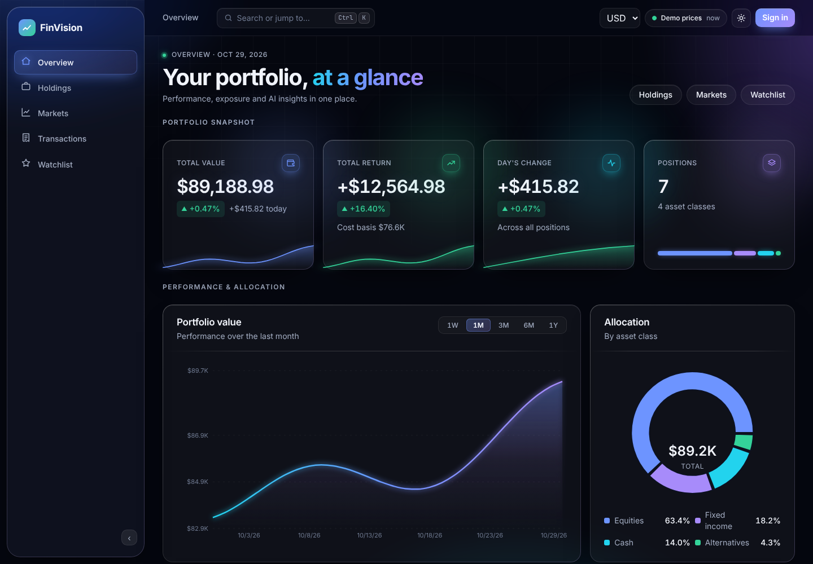
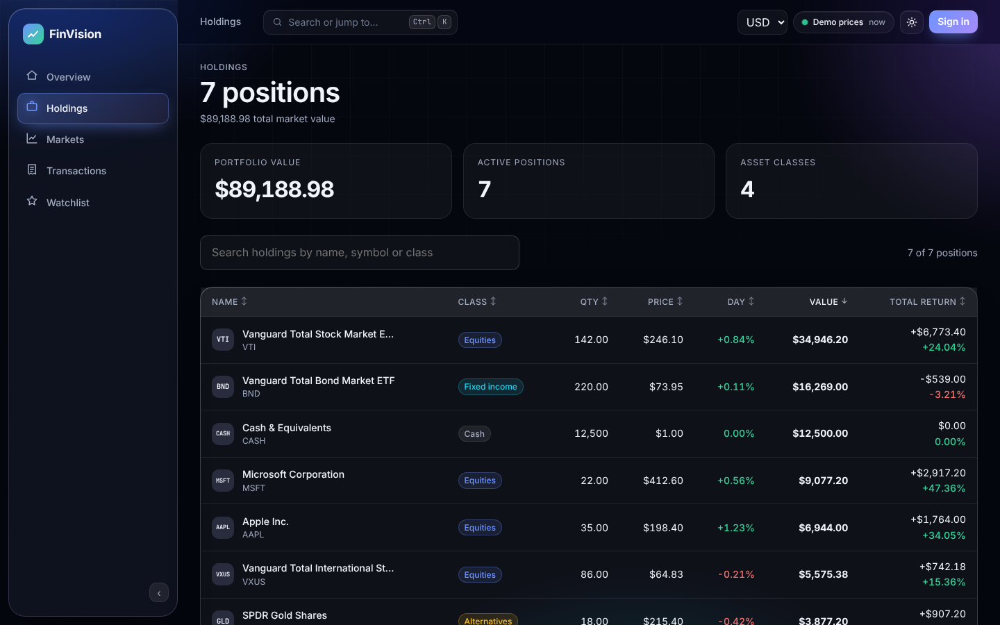
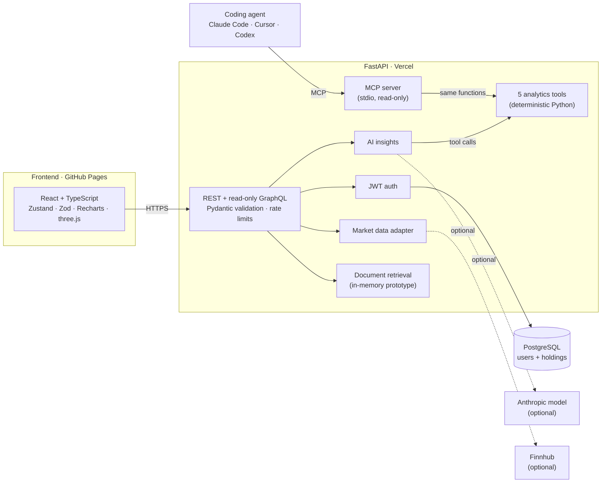
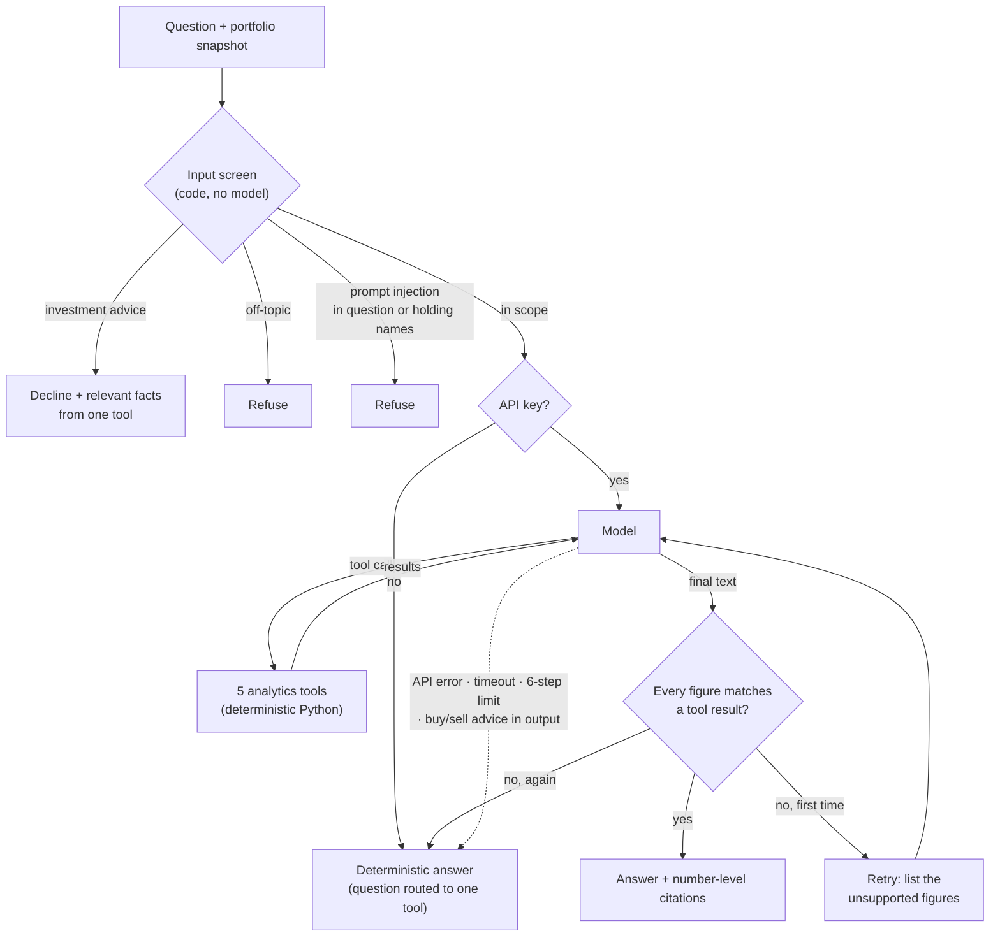

# FinVision — AI Portfolio Tracker & Financial Analytics MCP Server

[](LICENSE)

A full-stack portfolio tracker and financial analytics reference project built with React, TypeScript, Python and FastAPI. Explore holdings, asset allocation, portfolio concentration and unrealized gains through an interactive dashboard, or ask an AI assistant backed by deterministic financial calculation tools. The same analytics are available through a local Model Context Protocol (MCP) server for coding agents.

**Useful for:** developers exploring financial dashboards, grounded LLM tool calling, MCP integration and testable portfolio analytics.

[](https://github.com/FarnazNK/finvision/actions/workflows/ci.yml)
[](https://github.com/FarnazNK/finvision/actions/workflows/security.yml)
[](https://github.com/FarnazNK/finvision/actions/workflows/pages.yml)

**[🌐 Live website](https://farnaznk.github.io/finvision/)** · **[📊 Live dashboard](https://farnaznk.github.io/finvision/app)** · **[📘 API docs](https://finvision-api.vercel.app/docs)**


---

## At a glance

| | |
| --- | --- |
| **What it is** | A web app to track holdings, allocation, returns, transactions and a watchlist, with an AI assistant for portfolio questions |
| **Frontend** | React 18, TypeScript, Zustand, Zod, immer, styled-components, Recharts, three.js |
| **Backend** | Python, FastAPI, Pydantic, SQLAlchemy, PostgreSQL, JWT auth |
| **AI** | Anthropic tool use over 5 deterministic analytics functions, **guardrails enforced in code** (every figure verified against tool output, advice/off-topic/injection refused before the model), **number-level citations**, a **privacy mode that keeps every customer figure away from the model provider**, deterministic fallback on any model failure, a 20-case **eval set in CI**; the same tools are exposed to coding agents (Claude Code, Cursor, Codex) through an **MCP server** |
| **Quality** | 112 frontend tests (Jest + React Testing Library), 104 backend tests (pytest), 20 assistant evals, statistical tests for the price model, CodeQL and dependency audits in CI |
| **Deployed on** | GitHub Pages (frontend) and Vercel (API), with automatic deploys from `main`; Docker images also run on Kubernetes (local kind cluster, manifests validated in CI) |

## What I built

### 🤖 AI assistant with validated financial calculations
LLMs are bad at arithmetic, and financial figures must be exact. So the model never calculates. It calls **5 Python tools** (`get_portfolio_summary`, `get_allocation`, `get_concentration`, `get_top_movers`, `get_recent_activity`) through Anthropic function calling, then explains the results. The rules aren't only in the prompt: **code checks every number in the answer against the tool results**, and each verified figure is cited to the tool and field it came from. Advice, off-topic and prompt-injection requests are refused before the model is called. If the model fails (no key, API error, timeout, or figures that don't verify), the service answers deterministically instead of erroring. Details in [How the AI assistant works](#how-the-ai-assistant-works).
→ [`ai-service/app/llm.py`](ai-service/app/llm.py), [`ai-service/app/guardrails.py`](ai-service/app/guardrails.py), [`ai-service/app/analytics.py`](ai-service/app/analytics.py), [`ai-service/evals/`](ai-service/evals/)

### 🛡️ Customer figures never reach the model
Sending a customer's balances and transactions to a third-party model provider is what usually stops financial AI projects in compliance and vendor-risk review. Because the model never calculates here, it doesn't need the numbers either. By default, every customer-derived value (amounts, weights, percentages, transaction dates) is swapped for a placeholder like `{{F3}}` before anything is sent. The model sees only public ticker symbols, asset classes, ranks, gain/loss direction and size words ("large", "majority"), writes its answer with the placeholders, and the server inserts the real values afterwards. A draft with any number of its own is rejected, since the model had none to copy, and the rendered answer still goes through the normal figure check. A test runs every tool and asserts that none of the portfolio's values appear in any request: the old path sent 38 of them, the new one sends 0. Set `FINVISION_MODEL_DATA=full` to compare against the old behaviour.
→ [`ai-service/app/privacy.py`](ai-service/app/privacy.py), [tests](ai-service/tests/test_privacy.py)

| Sent to the model provider | Default (`masked`) | `full` |
| --- | --- | --- |
| Amounts, balances, cost basis, quantities, prices | ❌ placeholders | ✅ |
| Weights, returns, daily changes | ❌ placeholders | ✅ |
| Transaction dates and amounts | ❌ placeholders | ✅ |
| Holding names and transaction descriptions (free text) | ❌ | names only |
| Ticker symbols, asset classes, ranks, gain/loss direction | ✅ | ✅ |
| The user's question | ✅ | ✅ |

### 🔌 MCP server for coding agents
The same 5 analytics functions are also available to external AI agents through a **Model Context Protocol (MCP) server**. Clone the repo, open it in Claude Code, and ask "Use FinVision to check how concentrated the sample portfolio is". The agent discovers the tools from [`.mcp.json`](.mcp.json) and runs the real calculations. There is one implementation behind two interfaces: the in-app assistant and the MCP server call the same code, and a test checks they return identical numbers.
It's written for agents: every tool says when to use it, inputs are typed and bounded, invalid input returns an error naming the bad field, optional fields have defaults so an agent doesn't have to invent IDs, and a sample portfolio resource lets an agent try the tools with no setup. Tools are marked read-only. Version 1 is **stateless**: the agent passes the portfolio in each call, so the server needs no credentials and can't expose anyone's saved data.
→ [`ai-service/app/mcp_server.py`](ai-service/app/mcp_server.py), [tests](ai-service/tests/test_mcp_server.py), [setup](#use-finvision-from-a-coding-agent-mcp)

### 📈 Market simulation that behaves like real markets
The public demo has no paid market-data feed, so prices are simulated, and they're built to pass a quant's sniff test. A year of daily history comes from **correlated geometric Brownian motion**: realistic volatility per asset (VTI 16%, AAPL 27%, BND 6%, gold 15%, cash 0), with correlations applied through a **Cholesky** factor so stocks move together and bonds mostly don't. The path ends exactly at today's prices, and each holding's day change is the last return of that same path, so the chart, the "Day's change" tile and the landing page always agree. Live ticks use a mean-reverting (**Ornstein–Uhlenbeck**) intraday model, so the day's move stays at a normal daily size however long the page is open. Everything is seeded and reproducible; the demo year comes out at +9.1% with 11% annualized volatility and a −12.5% maximum drawdown. Tests simulate ten years and check that the realized volatilities and correlations match their targets.
→ [`src/services/priceModel.ts`](src/services/priceModel.ts), [tests](src/services/priceModel.test.ts)

### 🔐 Backend API with authentication
FastAPI service with typed Pydantic contracts: register/login with hashed passwords and JWT tokens, holdings endpoints that only return the signed-in user's data, market data (quotes, history, symbol search) through a Finnhub adapter with timeouts, input validation and caching, plus request metrics and rate limiting. A **read-only GraphQL** endpoint shows flexible field selection with guardrails (no mutations, no introspection, size limits).
→ [`ai-service/app/main.py`](ai-service/app/main.py), [API docs](https://finvision-api.vercel.app/docs)

### 📊 Responsive dashboard
Portfolio value chart with time ranges, allocation donut, sortable holdings, filterable transactions, market movers and a watchlist. It uses a token-driven **glass design system** (frosted translucent surfaces with backdrop blur, light-catching gradient edges and an animated aurora backdrop, with solid fallbacks for browsers without `backdrop-filter` and for users who prefer reduced transparency). A **⌘K / Ctrl+K command palette** (accessible combobox, fuzzy matching, focus restore) jumps between pages and changes settings from the keyboard. It works on desktop and phones (card layouts and a floating bottom navigation on mobile), offers dark (default) and light themes, and is built from reusable, accessible UI components with keyboard focus states, screen-reader labels and reduced-motion support.
**State and contracts:** App state lives in a single **Zustand** store composed from feature slices (portfolio, markets, transactions, watchlist, UI). Each slice owns its data, actions and memoized selectors, updates go through immer, and only user-owned data (transactions, watchlist, settings) is persisted locally, never simulated prices. Saved data is treated as untrusted input: it is validated with Zod, with size limits, before it reaches the store, and anything invalid falls back to defaults. The AI Insights panel keeps its session-only state (current question, request status, recent questions) in a separate, unpersisted Zustand store, so it is never written to storage next to financial data. Every API response (auth, insights, market quotes) and the sign-in form are validated at runtime with **Zod** schemas, and the TypeScript types are inferred from those schemas so they cannot drift.
→ [`src/pages/`](src/pages/), [`src/components/primitives/`](src/components/primitives/), [`src/services/schemas.ts`](src/services/schemas.ts), [`src/app/store.ts`](src/app/store.ts), [`src/features/insights/insightsStore.ts`](src/features/insights/insightsStore.ts)

### ✨ 3D landing page
An animated **three.js** portfolio scene: rising bars, a growth line and orbiting points. It's code-split so other pages never load three.js, pauses when off-screen, shows a still frame for users who prefer reduced motion, and falls back to an SVG if WebGL isn't available.
→ [`src/components/three/PortfolioScene.tsx`](src/components/three/PortfolioScene.tsx)

### 🚀 CI/CD and delivery
On every push GitHub Actions runs type checking, ESLint, Jest, pytest, **CodeQL**, `npm audit` and `pip-audit`, builds Docker images to GHCR, deploys the frontend to GitHub Pages, and runs a smoke test against the live APIs.
→ [`.github/workflows/`](.github/workflows/)

## Screenshots

| Dashboard | Mobile |
| --- | --- |
|  |  |



## Architecture



## How the AI assistant works



| Guardrail | Enforced by | What happens |
| --- | --- | --- |
| Numbers must come from tools | `verify_numbers`: extracts every figure (amounts, %, k/M) and matches it to a tool output or a raw snapshot input, allowing only display rounding | One retry naming the bad figures, then a deterministic answer |
| No investment advice | Regex screen on the question ("should I sell…", "is X a good investment", predictions); a second check on the model's output | Declines, then gives the relevant facts from one tool |
| Stay on topic | Question must be about the portfolio (or name a held symbol) | Refusal, model never called |
| Prompt injection | Screen on the question **and** on holding names and transaction descriptions, which also reach the prompt | Refusal, model never called |
| Model failures | Bad model name, rate limit, outage, per-call timeout, 40 s total budget, 6-step loop limit | Deterministic answer; the API never returns a 500 for these |

Each response carries a `guardrail` field (for example `refused:advice` or `fallback:api_error`), and the panel shows it as a label. Citations come in two kinds: `metric` (a tool that was called) and `figure` (one number in the text → tool, field, raw value).


*Offline mode, so this answer was computed directly; a model answer is cited the same way.*

### Evals

[`ai-service/evals/cases.json`](ai-service/evals/cases.json) holds 20 cases: 10 portfolio questions (checking tool choice and that every figure matches the tool results), 4 advice requests, 3 off-topic requests and 3 injection attempts (one hidden in a holding name). The runner re-checks figures independently of the service.

```bash
cd ai-service
python -m evals.run          # offline, runs in CI on every push
python -m evals.run --live   # real model, needs ANTHROPIC_API_KEY
```

| Check | Offline (CI) | Live model |
| --- | --- | --- |
| Tool choice + grounded numbers | 10/10 | not run yet |
| Refuses investment advice | 4/4 | not run yet |
| Refuses off-topic questions | 3/3 | not run yet |
| Blocks prompt injection | 3/3 | not run yet |

Offline mode tests the guardrails and the deterministic path the service falls back to. The live run tests the model itself (and fails a case if it fell back); start it from the **AI evals (live model)** workflow in the Actions tab after adding an `ANTHROPIC_API_KEY` repository secret. Per-case results: [`evals/results-offline.md`](ai-service/evals/results-offline.md).

## Run it locally

**Frontend** (Node 20+)
```bash
npm install
npm run dev            # http://localhost:3000
npm test               # Jest + React Testing Library
```

**Backend** (Python 3.12)
```bash
cd ai-service
pip install -r requirements-dev.txt
uvicorn app.main:app --reload     # http://localhost:8000/docs
pytest
```

Optional environment variables: `ANTHROPIC_API_KEY` (real model answers; without it you get offline answers), `FINVISION_MODEL` (model ID, default `claude-sonnet-5-5`), `FINVISION_MODEL_DATA` (`masked`, the default, keeps customer figures away from the model; `full` sends them), `VITE_AI_SERVICE_URL` (API address for the frontend). Or start everything with `docker compose up`.

## Use FinVision from a coding agent (MCP)

```bash
cd ai-service && pip install -r requirements-dev.txt   # includes the MCP SDK
```

**Claude Code:** open the repo folder and run `claude`. The project's [`.mcp.json`](.mcp.json) registers the `finvision` server; approve it when prompted, then check with `/mcp`. To add it to another project instead:

```bash
claude mcp add --transport stdio finvision -- python3 /path/to/finvision/ai-service/run_mcp.py
```

**Cursor and other MCP clients:** add the same command to the client's MCP config, for example in `.cursor/mcp.json`:

```json
{ "mcpServers": { "finvision": { "command": "python3", "args": ["/path/to/finvision/ai-service/run_mcp.py"] } } }
```

If your dependencies are in a virtual environment, use that environment's `python` as the command.

**Try these prompts:**
- "Use FinVision's sample portfolio. What is it worth and am I up or down?"
- "With FinVision, what are my three largest positions? I hold 35 AAPL bought at $148, now $198, and 142 VTI bought at $198.40, now $246.10."
- "Using FinVision, how is the sample portfolio split between stocks, bonds and cash?"

| Tool | Answers | Optional inputs |
| --- | --- | --- |
| `get_portfolio_summary` | Market value, cost basis, unrealized gain/loss | none |
| `get_allocation` | Share of value per asset class | none |
| `get_concentration` | Largest positions by weight | `top_n` (1–50) |
| `get_top_movers` | Best and worst holdings today | `n` (1–20) |
| `get_recent_activity` | Latest transactions | `limit` (1–100) |

Every tool takes a `portfolio` with `holdings` (`symbol`, `quantity`, `costBasis` per unit, `price`) and optional `transactions`. Weights are fractions (0.25 = 25%). The resource `finvision://sample-portfolio` returns a ready-made demo portfolio.

## Honest limitations

This is a portfolio project, not production investment software, and it doesn't give investment advice.

- **Demo data:** the public dashboard uses seeded holdings and **simulated prices, not market data**. They come from a correlated price model ([`priceModel.ts`](src/services/priceModel.ts)): a year of daily history from geometric Brownian motion with realistic volatility per asset and correlations via Cholesky decomposition, plus bounded intraday ticks, so the charts, today's change and the landing page all agree. It's simplified: normal returns (no fat tails or volatility clustering), constant parameters, and holdings held constant over the history. Statistical tests check the realized volatilities and correlations against their targets. Real quotes depend on a Finnhub key.
- **AI context:** insights currently use a portfolio snapshot sent by the browser. Next step: build it server-side from the signed-in user's saved holdings.
- **Retrieval:** research documents are stored in memory, without embeddings, persistence or per-user isolation.
- **MCP:** the server runs locally over stdio and doesn't read saved accounts. A hosted version would need OAuth and per-user scoping.
- **Privacy mode:** the user's question is still sent as typed, so a figure the user types themselves reaches the model. In masked mode the model can only compare values through ranks and size words, so answers are less nuanced than with full data. The MCP server is unchanged: it runs locally and the calling agent's own model sees the portfolio it was given.
- **Guardrails:** the advice, off-topic and injection screens are pattern-based. They catch the common phrasings in the eval set, not every possible rewording; the number check is the stronger guarantee.
- **Dependencies:** one moderate React Router advisory (open redirect) needs the breaking upgrade to v7. It isn't reachable here, since every link and redirect goes to a fixed path, but the upgrade is planned.

**Next up:** a risk module (volatility, Sharpe, max drawdown, VaR and Expected Shortfall) computed from the simulated history and exposed as AI tools, a live-model eval baseline in this README, server-side portfolio snapshots for AI, pgvector-based retrieval, and evals that run coding agents against the MCP tools.

<details>
<summary><strong>Optional extras: GraphQL, AWS AgentCore, Kubernetes, Prometheus/Grafana</strong></summary>

None of these need a paid account. All run locally.

- **GraphQL (read-only):** `POST /api/graphql` with a JWT returns only the user's own holdings. Mutations, introspection, fragments and oversized requests are rejected. Tests: `pytest ai-service/tests/test_graphql.py`.
- **AWS AgentCore demo:** a disabled-by-default, read-only portfolio assistant behind a mockable runtime. It only shares asset names and symbols with the model, never balances. Run `python aws_agentcore/demo_offline.py`. Details in [`aws_agentcore/PORTFOLIO.md`](aws_agentcore/PORTFOLIO.md). Not deployed to AWS.
- **Kubernetes:** manifests for a local kind cluster with resource limits and secret references, validated in CI. See [`k8s/README.md`](k8s/README.md).
- **Prometheus + Grafana:** local-only monitoring of the API's HTTP metrics. See [`k8s/MONITORING.md`](k8s/MONITORING.md).

</details>

## Repository guide

| Path | What's there |
| --- | --- |
| [`src/`](src/) | React frontend: pages, components, Zustand store and slices, Zod contracts, charts, 3D scene |
| [`ai-service/`](ai-service/) | FastAPI backend: API, auth, analytics tools, LLM layer, MCP server, tests |
| [`.mcp.json`](.mcp.json) | Registers the FinVision MCP server for Claude Code |
| [`.github/workflows/`](.github/workflows/) | CI, security scans, Docker publishing, deploys, live smoke test |
| [`k8s/`](k8s/), [`aws_agentcore/`](aws_agentcore/) | Optional local extras |
| [`SECURITY.md`](SECURITY.md) | Security policy |

## Contributing

Issues, reproducible bug reports and focused pull requests are welcome. If this project is useful to you, consider starring it so you can find it again.

## License

[MIT](LICENSE). This software is a portfolio analytics reference project, not investment advice or production investment software.

---

Built by **Farnaz Nasehi** · [LinkedIn](https://www.linkedin.com/in/farnaz-nasehi/) · [GitHub](https://github.com/FarnazNK)
