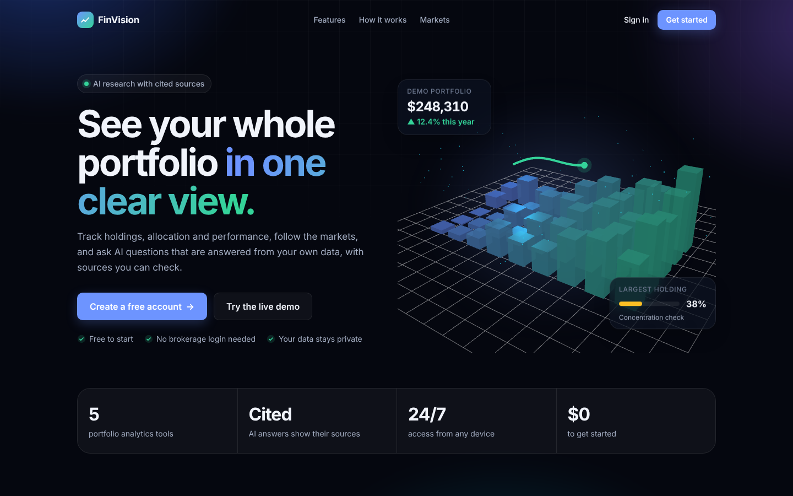
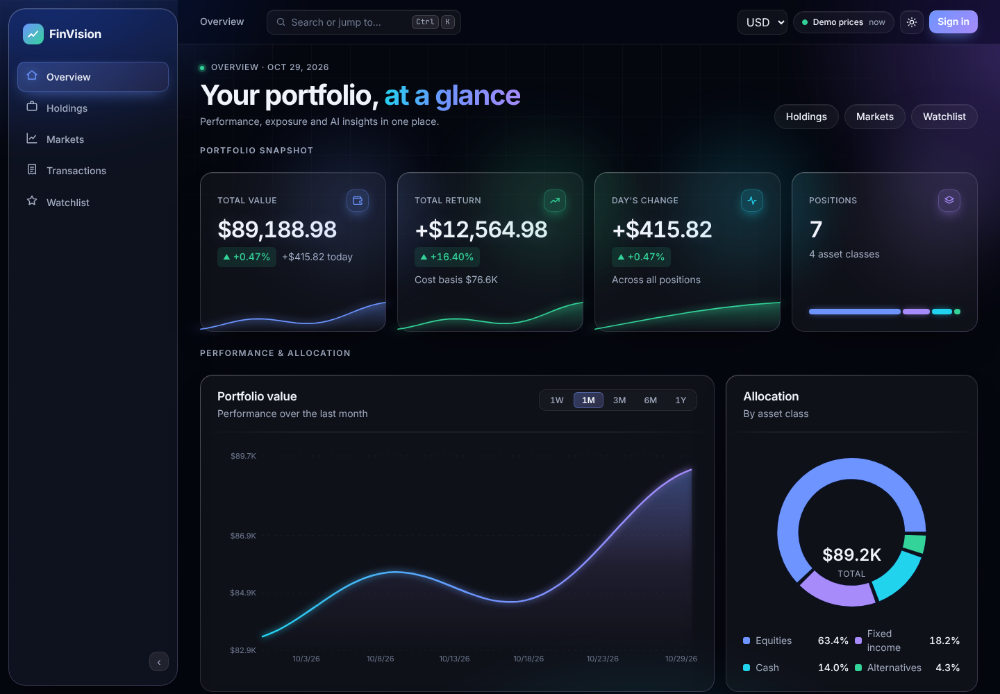
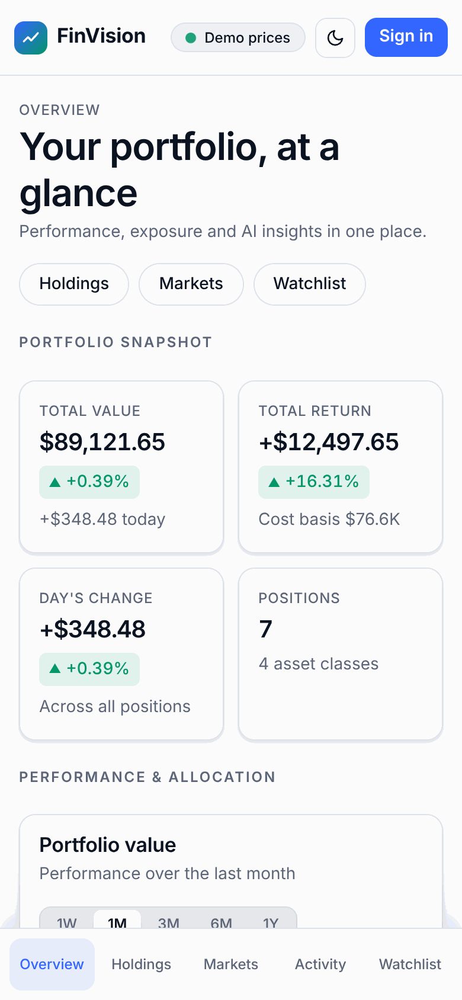
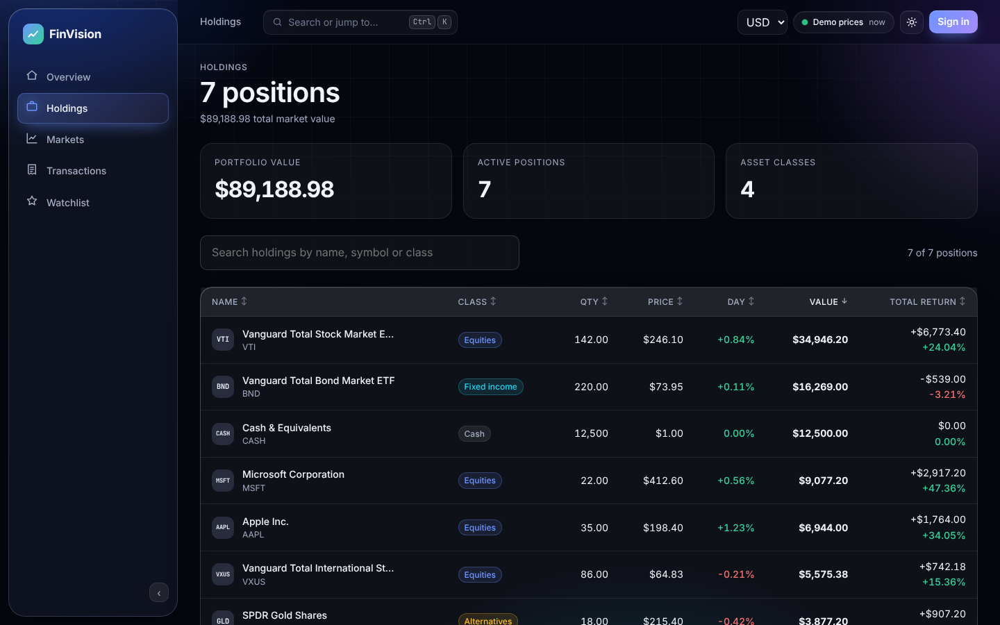
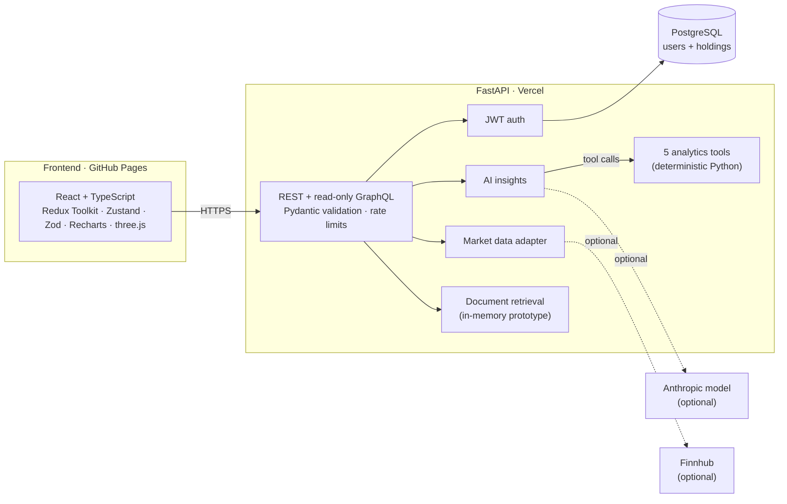

# FinVision

**A full-stack, AI-assisted portfolio tracker.** React + TypeScript frontend, Python/FastAPI backend, and an AI assistant that answers questions about a portfolio by calling real calculation tools instead of guessing numbers.

[](https://github.com/FarnazNK/finvision/actions/workflows/ci.yml)
[](https://github.com/FarnazNK/finvision/actions/workflows/security.yml)
[](https://github.com/FarnazNK/finvision/actions/workflows/pages.yml)

**[🌐 Live website](https://farnaznk.github.io/finvision/)** · **[📊 Live dashboard](https://farnaznk.github.io/finvision/app)** · **[📘 API docs](https://finvision-api.vercel.app/docs)**



---

## At a glance

| | |
| --- | --- |
| **What it is** | A web app to track holdings, allocation, returns, transactions and a watchlist, with an AI assistant for portfolio questions |
| **Frontend** | React 18, TypeScript, Redux Toolkit, Zustand, Zod, styled-components, Recharts, three.js |
| **Backend** | Python, FastAPI, Pydantic, SQLAlchemy, PostgreSQL, JWT auth |
| **AI** | Anthropic tool use over 5 deterministic analytics functions, cited answers, offline fallback |
| **Quality** | 68 frontend tests (Jest + React Testing Library), 18 backend tests (pytest), CodeQL and dependency audits in CI |
| **Deployed on** | GitHub Pages (frontend) and Vercel (API), with automatic deploys from `main`; Docker images also run on Kubernetes (local kind cluster, manifests validated in CI) |

## What I built

### 🤖 AI assistant that doesn't make up numbers
LLMs are bad at arithmetic, and financial figures must be exact. So the model never calculates. It calls **5 Python tools** (`get_portfolio_summary`, `get_allocation`, `get_concentration`, `get_top_movers`, `get_recent_activity`) through Anthropic function calling, then explains the results. Each answer **cites the tools it used**, so it can be checked. Without an API key the service falls back to deterministic answers, so the demo and CI never depend on an external model.
→ [`ai-service/app/llm.py`](ai-service/app/llm.py), [`ai-service/app/analytics.py`](ai-service/app/analytics.py)

### 🔐 Backend API with authentication
FastAPI service with typed Pydantic contracts: register/login with hashed passwords and JWT tokens, holdings endpoints that only return the signed-in user's data, market data (quotes, history, symbol search) through a Finnhub adapter with timeouts, input validation and caching, plus request metrics and rate limiting. A **read-only GraphQL** endpoint shows flexible field selection with guardrails (no mutations, no introspection, size limits).
→ [`ai-service/app/main.py`](ai-service/app/main.py), [API docs](https://finvision-api.vercel.app/docs)

### 📊 Responsive dashboard
Portfolio value chart with time ranges, allocation donut, sortable holdings, filterable transactions, market movers and a watchlist. It works on desktop and phones (card layouts and bottom navigation on mobile), offers light and dark themes, and is built from reusable, accessible UI components with keyboard focus states, screen-reader labels and reduced-motion support.
**State and contracts:** Redux Toolkit holds the durable app state (portfolio, transactions, watchlist, preferences) and persists it locally. The AI Insights panel keeps its session-only state (current question, request status, recent questions) in a small **Zustand** store, so it is never written to storage next to financial data. Every API response (auth, insights, market quotes) and the sign-in form are validated at runtime with **Zod** schemas, and the TypeScript types are inferred from those schemas so they cannot drift.
→ [`src/pages/`](src/pages/), [`src/components/primitives/`](src/components/primitives/), [`src/services/schemas.ts`](src/services/schemas.ts), [`src/features/insights/insightsStore.ts`](src/features/insights/insightsStore.ts)

### ✨ 3D landing page
An animated **three.js** portfolio scene: rising bars, a growth line and orbiting points. It's code-split so other pages never load three.js, pauses when off-screen, shows a still frame for users who prefer reduced motion, and falls back to an SVG if WebGL isn't available.
→ [`src/components/three/PortfolioScene.tsx`](src/components/three/PortfolioScene.tsx)

### 🚀 CI/CD and delivery
On every push GitHub Actions runs type checking, ESLint, Jest, pytest, **CodeQL**, `npm audit` and `pip-audit`, builds Docker images to GHCR, deploys the frontend to GitHub Pages, and runs a smoke test against the live APIs.
→ [`.github/workflows/`](.github/workflows/)

## Screenshots

| Dashboard | Mobile |
| --- | --- |
|  |  |



## Architecture



## Run it locally

**Frontend** (Node 20+)
```bash
npm install
npm run dev            # http://localhost:3000
npm test               # Jest + React Testing Library
```

**Backend** (Python 3.12)
```bash
cd ai-service
pip install -r requirements-dev.txt
uvicorn app.main:app --reload     # http://localhost:8000/docs
pytest
```

Optional environment variables: `ANTHROPIC_API_KEY` (real model answers; without it you get offline answers), `VITE_AI_SERVICE_URL` (API address for the frontend). Or start everything with `docker compose up`.

## Honest limitations

This is a portfolio project, not production investment software, and it doesn't give investment advice.

- **Demo data:** the public dashboard uses seeded holdings and simulated price ticks. Real quotes depend on a Finnhub key.
- **AI context:** insights currently use a portfolio snapshot sent by the browser. Next step: build it server-side from the signed-in user's saved holdings.
- **Retrieval:** research documents are stored in memory, without embeddings, persistence or per-user isolation.

**Next up:** server-side portfolio snapshots for AI, pgvector-based retrieval, and an evaluation set that checks AI answer quality in CI.

<details>
<summary><strong>Optional extras: GraphQL, AWS AgentCore, Kubernetes, Prometheus/Grafana</strong></summary>

None of these need a paid account. All run locally.

- **GraphQL (read-only):** `POST /api/graphql` with a JWT returns only the user's own holdings. Mutations, introspection, fragments and oversized requests are rejected. Tests: `pytest ai-service/tests/test_graphql.py`.
- **AWS AgentCore demo:** a disabled-by-default, read-only portfolio assistant behind a mockable runtime. It only shares asset names and symbols with the model, never balances. Run `python aws_agentcore/demo_offline.py`. Details in [`aws_agentcore/PORTFOLIO.md`](aws_agentcore/PORTFOLIO.md). Not deployed to AWS.
- **Kubernetes:** manifests for a local kind cluster with resource limits and secret references, validated in CI. See [`k8s/README.md`](k8s/README.md).
- **Prometheus + Grafana:** local-only monitoring of the API's HTTP metrics. See [`k8s/MONITORING.md`](k8s/MONITORING.md).

</details>

## Repository guide

| Path | What's there |
| --- | --- |
| [`src/`](src/) | React frontend: pages, components, Redux slices, Zustand store, Zod contracts, charts, 3D scene |
| [`ai-service/`](ai-service/) | FastAPI backend: API, auth, analytics tools, LLM layer, tests |
| [`.github/workflows/`](.github/workflows/) | CI, security scans, Docker publishing, deploys, live smoke test |
| [`k8s/`](k8s/), [`aws_agentcore/`](aws_agentcore/) | Optional local extras |
| [`SECURITY.md`](SECURITY.md) | Security policy |

---

Built by **Farnaz Nasehi** · [LinkedIn](https://www.linkedin.com/in/farnaz-nasehi/) · [GitHub](https://github.com/FarnazNK)
