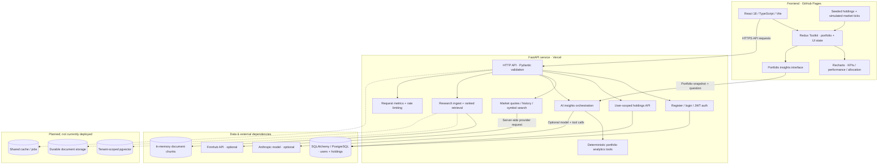

# FinVision

**AI-assisted portfolio intelligence**

### Technology stack

**Frontend**

      

**Backend & database**

     

**AI, testing & delivery**

      

FinVision is a full-stack financial analytics project exploring **reliable backend services**, **deterministic portfolio calculations**, and **AI-assisted research**. It combines a responsive portfolio dashboard with authenticated APIs and explainable AI responses.

> **Demo transparency:** The public dashboard can use simulated portfolio prices. External market quotes depend on provider configuration and availability, and should not be treated as guaranteed real-time prices. FinVision is a portfolio engineering project, not an investment-advice service.

## Project links

| Explore | Link |
| --- | --- |
| Live dashboard | [FinVision](https://farnaznk.github.io/finvision/) |
| FastAPI backend implementation | [Backend source](./ai-service/) |
| Hosted API documentation | [OpenAPI / Swagger UI](https://finvision-api.vercel.app/docs) |

The backend lives **in this repository** under `ai-service/`, alongside the React frontend. It implements HTTP endpoints, JWT authentication, SQLAlchemy models, and PostgreSQL-compatible persistence. The frontend and API are deployed separately.

**Data transparency:** The demo dashboard may use seeded holdings and simulated price ticks. External quotes depend on optional provider configuration and may be delayed. Simulated portfolio data does not mean the backend is mocked.

## Engineering highlights

### Backend engineering

- **FastAPI and Pydantic:** Defined HTTP contracts for authentication, portfolios, market quotes, AI insights, and research.
- **PostgreSQL and SQLAlchemy:** Persist users and holdings, with user-scoped portfolio reads and writes.
- **JWT authentication:** Password hashing, signed access tokens, and authenticated portfolio endpoints.
- **Market-data integration:** Optional server-side Finnhub adapter, bounded request timeouts, input validation, and in-process caching.
- **Testing and delivery:** pytest, Docker, GitHub Actions, and container builds.

### Applied AI

- **Grounded portfolio insights:** AI interpretation uses supplied portfolio snapshots and deterministic calculation tools rather than model-invented arithmetic.
- **Source-aware retrieval:** Research documents are chunked and ranked; retrieval responses include source URLs and chunk identifiers.
- **Graceful fallback:** A deterministic response keeps core insights demonstrable without an external model provider.
- **Honest boundaries:** Research retrieval currently uses an in-memory prototype; document persistence, tenant isolation, and production-grade retrieval evaluation require further work.

### Frontend

- **React + TypeScript:** Vite, Redux Toolkit, React Router, and styled-components.
- **Financial visualizations:** Portfolio KPIs, performance charts, asset allocation, holdings, transactions, and watchlists.
- **AI assistant interface:** Natural-language questions about the displayed portfolio.
- **Responsive layout:** Desktop and mobile navigation with accessible interface components.

## Architecture

FinVision separates the static React dashboard from its Python API. The diagram distinguishes **implemented components** (solid links) from **planned infrastructure** (dashed links).

### Frontend and data flow

The frontend is a Vite-built single-page application with React Router, Redux Toolkit, styled-components, and Recharts. Redux-backed demo holdings and simulated ticks drive the dashboard; they should **not** be confused with exchange-verified live prices. The backend's user-scoped holdings API is separate from those browser-generated demo values.

### Authentication and persistence

The backend uses FastAPI/Pydantic contracts, password hashing, JWT access tokens, SQLAlchemy models, and user-scoped database queries. It supports local SQLite configuration and PostgreSQL for hosted deployments. Authorization is implemented on authenticated holdings endpoints; this does **not** imply all research data is tenant-isolated.

### Market data and AI

- The optional Finnhub adapter requests quotes, candles, and symbol search from the backend with timeout handling and a small in-process cache. Provider availability and quote freshness are not guaranteed.
- The portfolio insights endpoint accepts a **caller-supplied portfolio snapshot**, runs deterministic analytics, and can use an optional Anthropic model for natural-language interpretation and tool calls. Without its API key, the service uses a deterministic fallback. The server does **not yet** derive that snapshot from the authenticated user's holdings.
- The research prototype chunks documents and returns ranked excerpts with source metadata. Storage is **in memory**, not durable or tenant-isolated. A production retrieval system would need access controls, persistent ingestion, embeddings/vector search, and retrieval evaluation.

### Operations and boundaries

Docker and nginx provide containerized application packaging; GitHub Actions runs frontend and backend checks. The deployed demo uses GitHub Pages for its frontend and Vercel for its API. PostgreSQL is a runtime dependency for the configured hosted backend; Redis, pgvector, and object storage in the diagram are **future integrations**, not deployed features.

## Technology

| Layer | Stack |
| --- | --- |
| Frontend | React 18, TypeScript, Vite, Redux Toolkit, styled-components, Recharts |
| Backend | Python, FastAPI, Pydantic, SQLAlchemy, PostgreSQL |
| AI | Anthropic integration (optional), deterministic analytics, document retrieval |
| Testing | Jest, React Testing Library, pytest |
| Delivery | Docker, GitHub Actions, GitHub Pages, Vercel |

## Current limitations and next steps

FinVision is a portfolio project with a deployed demo, **not a claim of production-grade investment infrastructure**.

- Quotes are provider-dependent; simulated values remain in the demo.
- AI portfolio questions use a caller-supplied snapshot; authenticated server-derived snapshots are a future security improvement.
- Research documents are not yet durable or tenant-isolated.
- Planned work includes secure persistent retrieval, expanded retrieval and grounding evaluations, provider data freshness, and distributed observability.

## Repository guide

- [Backend and AI service](./ai-service/)
- [Frontend source](./src/)
- [Security policy](./SECURITY.md)
- [CI workflow](./.github/workflows/ci.yml)

For developer-focused installation details, consult the service documentation and project configuration files. **Never commit passwords, tokens, private keys, or populated environment files.** Configure secrets only in the deployment environment; rotate any credentials that have ever been exposed.

---

Built to demonstrate practical full-stack, backend, and applied-AI engineering.
