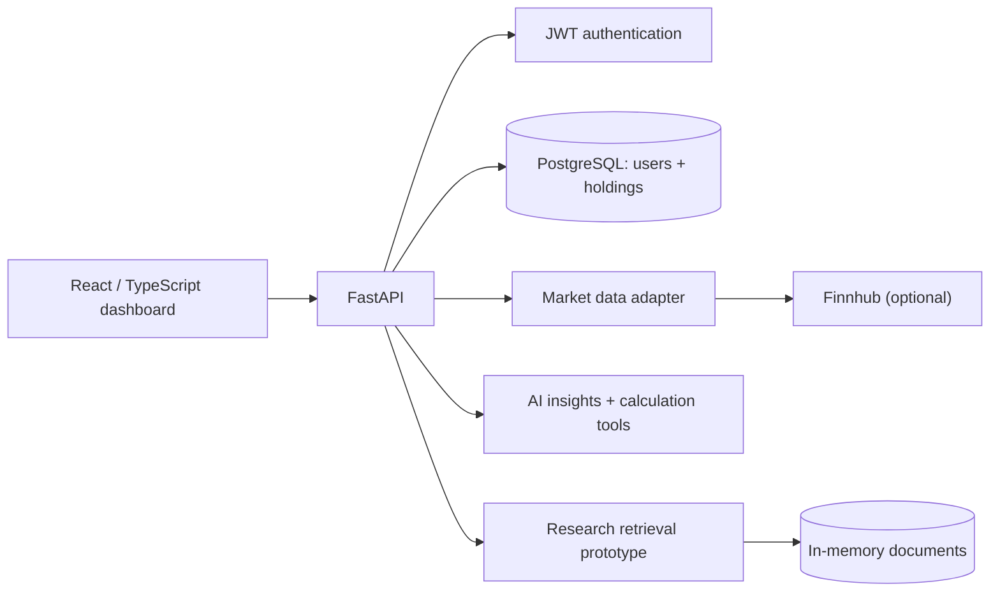

# FinVision

**AI-assisted portfolio intelligence**

**Tech stack:** React · TypeScript · Vite · Redux Toolkit · FastAPI · Python · PostgreSQL · SQLAlchemy · JWT · Docker · GitHub Actions · pytest · Jest

**AI & data:** Anthropic integration (optional) · Document retrieval prototype · Deterministic portfolio analytics · Finnhub market-data adapter (optional)

FinVision is a full-stack financial analytics project exploring **reliable backend services**, **deterministic portfolio calculations**, and **AI-assisted research**. It combines a responsive portfolio dashboard with authenticated APIs and explainable AI responses.

> **Demo transparency:** The public dashboard can use simulated portfolio prices. External market quotes depend on provider configuration and availability, and should not be treated as guaranteed real-time prices. FinVision is a portfolio engineering project, not an investment-advice service.

## Project links

| Explore | Link |
| --- | --- |
| Live dashboard | [FinVision](https://farnaznk.github.io/finvision/) |
| FastAPI backend implementation | [Backend source](./ai-service/) |
| Hosted API documentation | [OpenAPI / Swagger UI](https://finvision-api.vercel.app/docs) |

The backend lives **in this repository** under `ai-service/`, alongside the React frontend. It implements HTTP endpoints, JWT authentication, SQLAlchemy models, and PostgreSQL-compatible persistence. The frontend and API are deployed separately.

**Data transparency:** The demo dashboard may use seeded holdings and simulated price ticks. External quotes depend on optional provider configuration and may be delayed. Simulated portfolio data does not mean the backend is mocked.

## Engineering highlights

### Backend engineering

- **FastAPI and Pydantic:** Defined HTTP contracts for authentication, portfolios, market quotes, AI insights, and research.
- **PostgreSQL and SQLAlchemy:** Persist users and holdings, with user-scoped portfolio reads and writes.
- **JWT authentication:** Password hashing, signed access tokens, and authenticated portfolio endpoints.
- **Market-data integration:** Optional server-side Finnhub adapter, bounded request timeouts, input validation, and in-process caching.
- **Testing and delivery:** pytest, Docker, GitHub Actions, and container builds.

### Applied AI

- **Grounded portfolio insights:** AI interpretation uses supplied portfolio snapshots and deterministic calculation tools rather than model-invented arithmetic.
- **Source-aware retrieval:** Research documents are chunked and ranked; retrieval responses include source URLs and chunk identifiers.
- **Graceful fallback:** A deterministic response keeps core insights demonstrable without an external model provider.
- **Honest boundaries:** Research retrieval currently uses an in-memory prototype; document persistence, tenant isolation, and production-grade retrieval evaluation require further work.

### Frontend

- **React + TypeScript:** Vite, Redux Toolkit, React Router, and styled-components.
- **Financial visualizations:** Portfolio KPIs, performance charts, asset allocation, holdings, transactions, and watchlists.
- **AI assistant interface:** Natural-language questions about the displayed portfolio.
- **Responsive layout:** Desktop and mobile navigation with accessible interface components.

## Architecture

Financial analytics tools in the backend use deterministic calculations, but **the frontend dashboard also calculates values from its current portfolio state**. The seeded/demo portfolio and simulated market ticks are not verified market prices. Hosted AI is optional; provider quotes, persisted user holdings, and demo data are distinct sources.

## Technology

| Layer | Stack |
| --- | --- |
| Frontend | React 18, TypeScript, Vite, Redux Toolkit, styled-components, Recharts |
| Backend | Python, FastAPI, Pydantic, SQLAlchemy, PostgreSQL |
| AI | Anthropic integration (optional), deterministic analytics, document retrieval |
| Testing | Jest, React Testing Library, pytest |
| Delivery | Docker, GitHub Actions, GitHub Pages, Vercel |

## Current limitations and next steps

FinVision is a portfolio project with a deployed demo, **not a claim of production-grade investment infrastructure**.

- Quotes are provider-dependent; simulated values remain in the demo.
- AI portfolio questions use a caller-supplied snapshot; authenticated server-derived snapshots are a future security improvement.
- Research documents are not yet durable or tenant-isolated.
- Planned work includes secure persistent retrieval, expanded retrieval and grounding evaluations, provider data freshness, and distributed observability.

## Repository guide

- [Backend and AI service](./ai-service/)
- [Frontend source](./src/)
- [Security policy](./SECURITY.md)
- [CI workflow](./.github/workflows/ci.yml)

For developer-focused installation details, consult the service documentation and project configuration files. **Never commit passwords, tokens, private keys, or populated environment files.** Configure secrets only in the deployment environment; rotate any credentials that have ever been exposed.

---

Built to demonstrate practical full-stack, backend, and applied-AI engineering.
