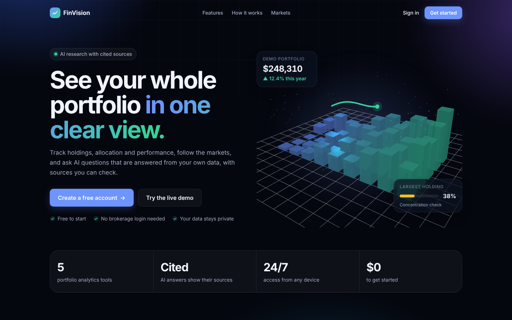
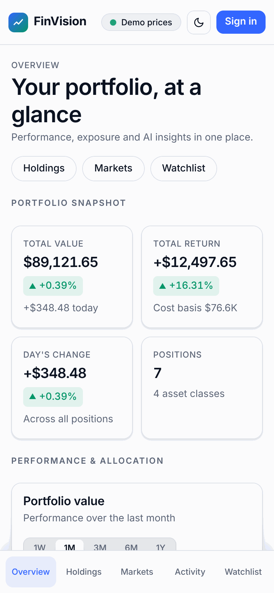
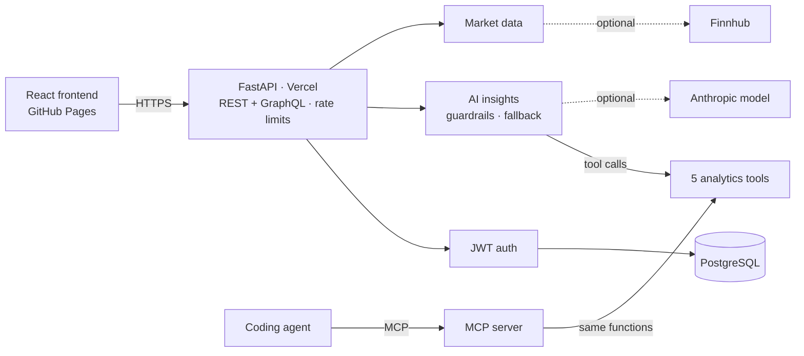
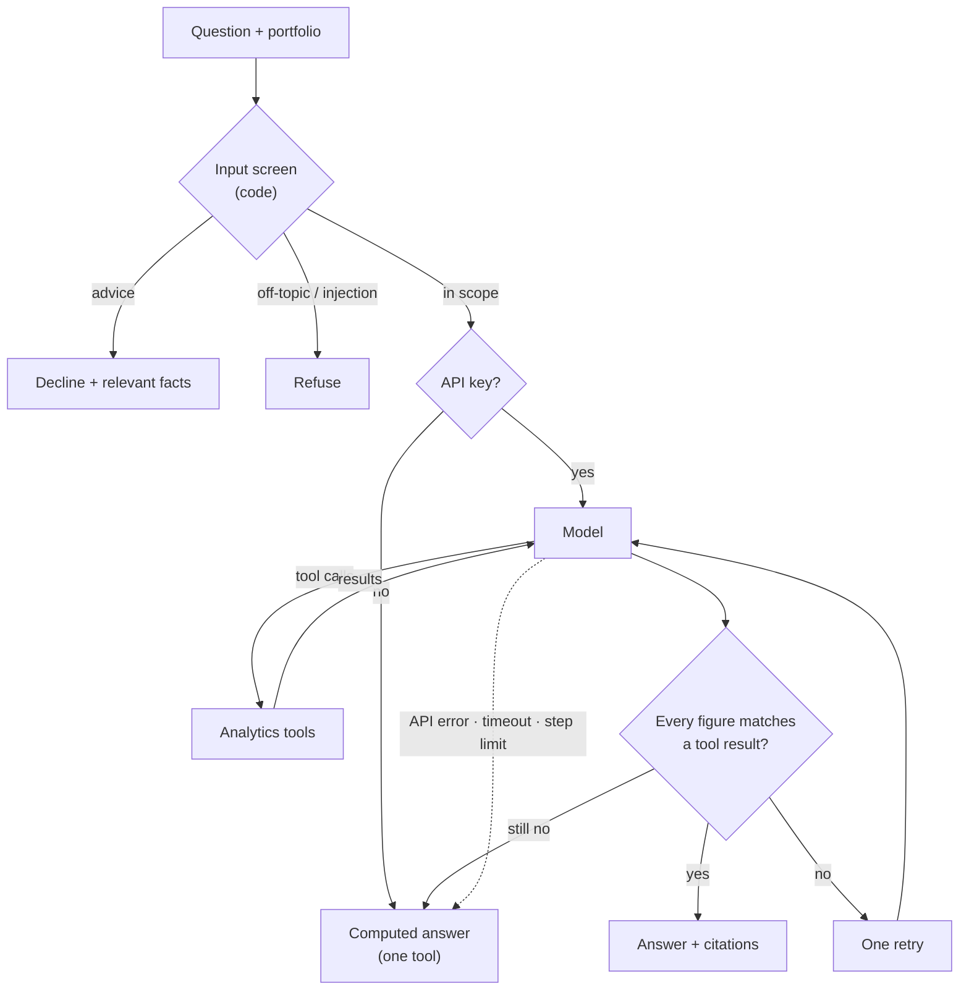
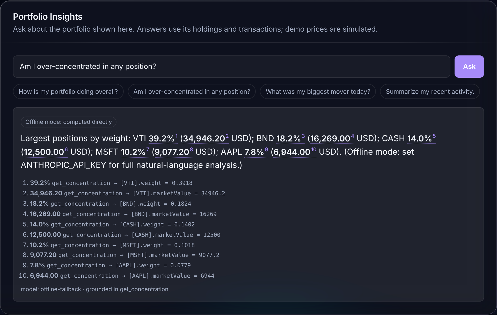

# FinVision

**A full-stack, AI-assisted portfolio tracker.** React + TypeScript frontend, FastAPI backend, and an AI assistant that answers portfolio questions by calling real calculation tools instead of guessing numbers.

[](https://github.com/FarnazNK/finvision/actions/workflows/ci.yml)
[](https://github.com/FarnazNK/finvision/actions/workflows/security.yml)
[](https://github.com/FarnazNK/finvision/actions/workflows/pages.yml)

**[🌐 Live website](https://farnaznk.github.io/finvision/)** · **[📊 Live dashboard](https://farnaznk.github.io/finvision/app)** · **[📘 API docs](https://finvision-api.vercel.app/docs)** · no sign-in needed ([what's live](#live-demo-status))



## At a glance

| | |
| --- | --- |
| **Frontend** | React 18, TypeScript, Zustand, Zod, immer, styled-components, Recharts, three.js |
| **Backend** | FastAPI, Pydantic, SQLAlchemy, PostgreSQL, JWT auth, read-only GraphQL |
| **AI** | Anthropic tool use over 5 deterministic analytics functions, guardrails enforced in code, number-level citations, deterministic fallback, 20-case eval set; the same tools exposed to coding agents via MCP |
| **Quality** | 93 frontend tests (Jest + RTL), 91 backend tests (pytest), 20 evals, CodeQL and dependency audits in CI |
| **Deployed** | GitHub Pages (frontend) and Vercel (API) from `main`; Docker images on GHCR; Kubernetes manifests validated in CI |

## What I built

**🤖 AI assistant that doesn't make up numbers.** The model never calculates: it calls 5 Python tools (summary, allocation, concentration, movers, recent activity) and explains the results. Code then checks every number in the answer against the tool output and cites each one to the tool and field it came from. Advice, off-topic and prompt-injection requests are refused before the model is called, and any model failure falls back to a computed answer instead of an error. → [`llm.py`](ai-service/app/llm.py), [`guardrails.py`](ai-service/app/guardrails.py), [`analytics.py`](ai-service/app/analytics.py)

**🔌 MCP server for coding agents.** The same 5 functions are available to Claude Code, Cursor or Codex over the Model Context Protocol, with one implementation behind both interfaces and a test that checks they return identical numbers. Tools are typed, bounded, read-only and stateless (the agent passes the portfolio), so the server needs no credentials. → [`mcp_server.py`](ai-service/app/mcp_server.py), [setup](#use-it-from-a-coding-agent-mcp)

**🔐 Backend API.** Register/login with hashed passwords and JWTs, per-user holdings, Finnhub market data (single and batch quotes, history, search) with timeouts and caching, per-IP rate limiting, read-only GraphQL (no mutations or introspection, size limits), and an in-memory document-retrieval prototype. → [`main.py`](ai-service/app/main.py), [endpoints](ai-service/README.md#endpoints)

**📊 Responsive dashboard.** Value chart (1W–1Y), allocation donut, sortable holdings, filterable transactions, market movers and a watchlist, for a seeded demo portfolio. Prices are **real market quotes** refreshed every minute when the API has a Finnhub key, otherwise simulated; the header badge says which ("Market prices" / "Demo prices"). Glass design system, ⌘K command palette, dark and light themes, mobile layout, and accessible components (keyboard focus, screen-reader labels, reduced motion). State lives in one Zustand store built from feature slices, and every API response is validated with Zod. → [`src/pages/`](src/pages/), [`store.ts`](src/app/store.ts), [`schemas.ts`](src/services/schemas.ts)

**✨ 3D landing page.** A code-split three.js scene that pauses off-screen, respects reduced motion and falls back to SVG without WebGL. → [`PortfolioScene.tsx`](src/components/three/PortfolioScene.tsx)

## Screenshots

| Dashboard | Mobile |
| --- | --- |
|  |  |

## Architecture



## How the AI assistant works



| Guardrail | How it's enforced |
| --- | --- |
| Numbers come from tools | Every figure (amounts, %, k/M) must match a tool output or raw input, allowing display rounding; one retry, then a computed answer |
| No investment advice | Pattern screen on the question and on the model's output; declines, then gives the relevant facts |
| On topic | The question must be about the portfolio or name a held symbol |
| Prompt injection | Screens the question and holding names / transaction descriptions, which also reach the prompt |
| Model failures | Bad model name, rate limit, outage, timeouts (40 s budget) and a 6-step limit all fall back; no 500s |

Each response has a `guardrail` field (e.g. `refused:advice`, `fallback:api_error`) that the panel shows as a label.



**Evals.** [20 cases](ai-service/evals/cases.json): 10 portfolio questions (right tool, every figure grounded), 4 advice, 3 off-topic and 3 injection attempts (one hidden in a holding name).

| Check | Offline (CI) | Live model |
| --- | --- | --- |
| Tool choice + grounded numbers | 10/10 | not run yet |
| Refuses advice / off-topic | 7/7 | not run yet |
| Blocks prompt injection | 3/3 | not run yet |

Offline runs test the guardrails and the fallback path on every push. The live run, started from the **AI evals (live model)** workflow, needs an `ANTHROPIC_API_KEY` repository secret.

## Live demo status

| Part | Status |
| --- | --- |
| Dashboard | Live on GitHub Pages with a seeded demo portfolio; no sign-in needed |
| Prices | Real quotes once `FINNHUB_API_KEY` is set on the API (free key); otherwise simulated |
| AI assistant | Live in **offline mode**: no Anthropic key on the API, so answers are computed directly. Guardrails and citations work the same |
| Accounts | Sign-in works, but the dashboard still shows the demo portfolio; saved holdings are available through the API and GraphQL only |

## Run it locally

```bash
npm install && npm run dev        # frontend: http://localhost:3000 · tests: npm test
cd ai-service && pip install -r requirements-dev.txt
uvicorn app.main:app --reload     # API: http://localhost:8000/docs · tests: pytest, python -m evals.run
```

Optional: `ANTHROPIC_API_KEY` (model answers), `FINVISION_MODEL` (default `claude-sonnet-5-5`), `FINNHUB_API_KEY` (real prices), `VITE_AI_SERVICE_URL` (API address for the frontend). Or run everything with `docker compose up`.

## Use it from a coding agent (MCP)

Open the repo in **Claude Code** (`claude`); [`.mcp.json`](.mcp.json) registers the `finvision` server. Elsewhere, or in **Cursor**:

```bash
claude mcp add --transport stdio finvision -- python3 /path/to/finvision/ai-service/run_mcp.py
```
```json
{ "mcpServers": { "finvision": { "command": "python3", "args": ["/path/to/finvision/ai-service/run_mcp.py"] } } }
```

Try: *"Use FinVision's sample portfolio. What is it worth and am I up or down?"* Tools: `get_portfolio_summary`, `get_allocation`, `get_concentration` (`top_n`), `get_top_movers` (`n`), `get_recent_activity` (`limit`). Each takes a `portfolio` of holdings (`symbol`, `quantity`, `costBasis`, `price`) and optional transactions; `finvision://sample-portfolio` gives a ready-made one.

## CI/CD

| Workflow | Runs on | Does |
| --- | --- | --- |
| CI | Pushes and PRs to `main` | Typecheck, ESLint, Jest, build, pytest, offline evals, Compose build |
| Security | Pushes, PRs, weekly | CodeQL, `pip-audit`, `npm audit` |
| Deploy / Docker / Kubernetes | Pushes to `main` | GitHub Pages deploy, GHCR images, manifest validation |
| Live evals / smoke test | Manual | Evals against the real model; health checks on the deployed API |

Vercel deploys the API from `main` and builds a preview for every branch.

## Limitations

A portfolio project, not investment software, and it gives no investment advice.

- The dashboard always shows the seeded portfolio, and the value chart's history before page load is simulated.
- The assistant uses a snapshot sent by the browser, not the user's saved holdings.
- Guardrail screens are pattern-based and catch common phrasings, not every rewording; the number check is the stronger guarantee.
- Rate limiting is per IP and in memory, so it resets on cold starts.
- Retrieval is in memory, without embeddings or per-user isolation. MCP runs locally over stdio.

**Next up:** live-model eval results, saved holdings in the dashboard, server-side AI snapshots, pgvector retrieval.

<details>
<summary><strong>Optional extras: GraphQL, AWS AgentCore, Kubernetes, Prometheus</strong></summary>

- **GraphQL:** `POST /api/graphql` with a JWT returns only the user's own holdings; mutations, introspection, fragments and oversized requests are rejected.
- **AWS AgentCore:** a disabled-by-default, read-only assistant that shares only asset names and symbols with the model. Run `python aws_agentcore/demo_offline.py`. Not deployed. [Details](aws_agentcore/PORTFOLIO.md).
- **Kubernetes:** kind manifests with resource limits and secret references. [`k8s/README.md`](k8s/README.md).
- **Prometheus + Grafana:** local manifests. Known issue: a token-protected `/metrics` route shadows the Prometheus one, so scrapes get a 401. [`k8s/MONITORING.md`](k8s/MONITORING.md).

</details>

---

Built by **Farnaz Nasehi** · [LinkedIn](https://www.linkedin.com/in/farnaz-nasehi/) · [GitHub](https://github.com/FarnazNK)
